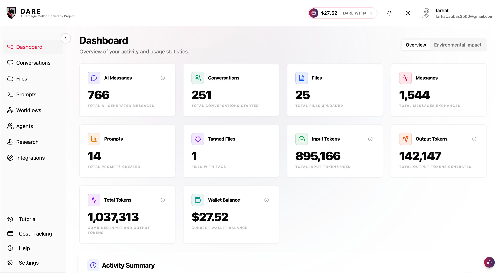
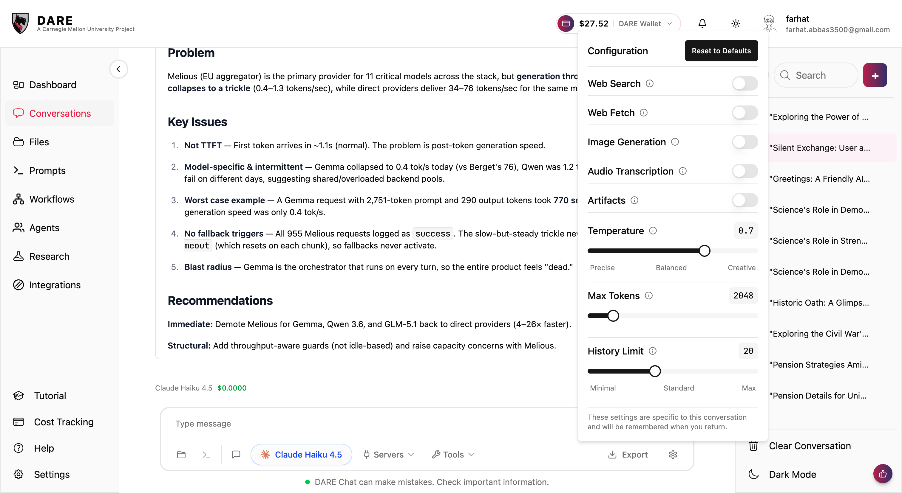
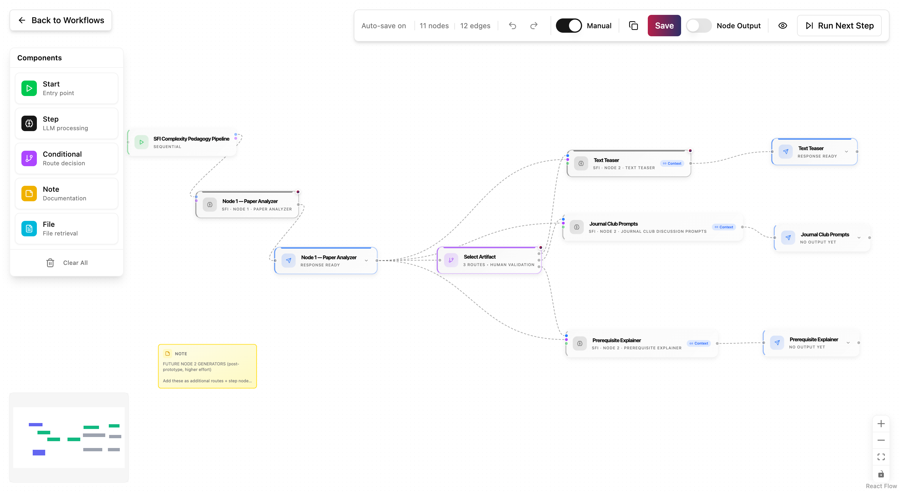
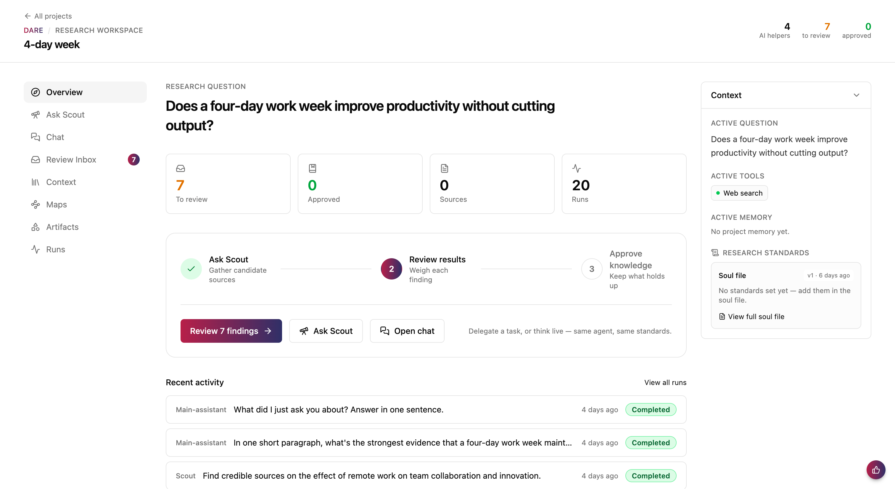
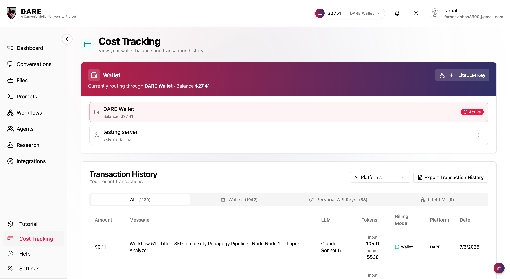
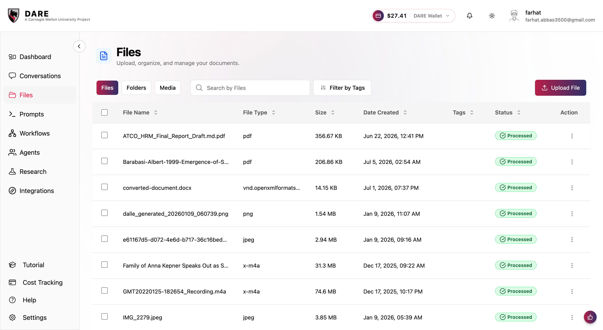
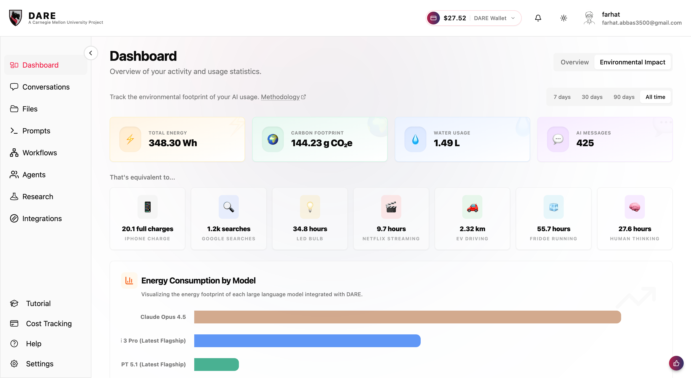
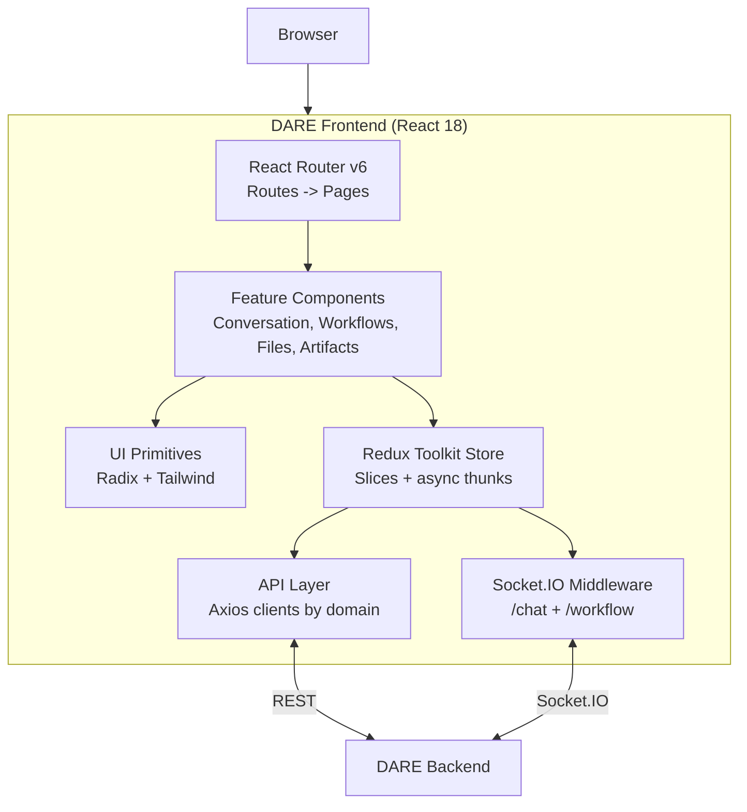

# DARE Frontend

[](LICENSE)
[](https://nodejs.org/)

> React/TypeScript frontend for the **Dietrich Analysis Research Education (DARE) Platform**.

## What is DARE?

The Dietrich Analysis Research Education (DARE) Platform is an open-source, multi-LLM research and
conversation platform. It gives you one vendor-agnostic interface to OpenAI, Anthropic Claude,
Google Gemini and self-hosted LLaMA models, with file-grounded retrieval (RAG), Model Context
Protocol (MCP) tools, visual multi-step workflows and real-time streaming.

DARE is built for researchers and institutions that need more than a chatbot: document
intelligence, reproducible workflows and per-user usage tracking in one place.

**This repository is the DARE web frontend**, the main user interface for the platform. It talks to
the [DARE backend](https://github.com/cmudco/dare-backend/) over REST and Socket.IO, and handles:

- The browser UI for chat, files, workflows, research, usage and settings
- Client state in Redux Toolkit and live streaming over Socket.IO
- The `/docs` site in `docs-site/`, built into the same `dist/` as the app

> **DARE runs standalone.** The DARE frontend and backend are all you need to run the platform.
> SocraticBooks is a separate, optional platform built on top of DARE.

## Screenshots

**Usage dashboard** — activity, conversations, tokens, and wallet balance, all at a glance the
moment you land:

<p align="center">
  
</p>

|                                                                                                                                                                                                          |                                                                                                                                                                                                                                                                                         |
| :------------------------------------------------------------------------------------------------------------------------------------------------------------------------------------------------------: | :-------------------------------------------------------------------------------------------------------------------------------------------------------------------------------------------------------------------------------------------------------------------------------------: |
| **Multi-LLM chat** — streaming conversations with per-conversation tools and controls<br/> |                                              **Workflow builder** — multi-step pipelines with conditional routing and human validation<br/>                                              |
|  **Research mode** — agent-gathered sources, human-reviewed before becoming knowledge<br/>   |                                              **Cost tracking** — a wallet per user, a ledger per message<br/>                                               |
|                   **Files & RAG** — upload and tag a corpus, ground answers in it<br/>                   | **Environmental impact** — every message metered for energy, carbon, and water, with per-model breakdowns and real-world equivalents<br/> |

## Overview



The frontend is a static single-page app. A Redux Toolkit store drives the feature components, an
Axios API layer calls the backend over REST, and Socket.IO middleware streams chat and workflow
events. [docs/explanation/architecture.md](docs/explanation/architecture.md) has the full picture.

## Features

- **Multi-LLM chat.** Streaming conversations with OpenAI, Anthropic, Google and self-hosted LLaMA
  models.
- **File-grounded RAG.** Upload documents and reference them in chat.
- **Visual workflow builder.** Design and run multi-step AI workflows as a DAG.
- **Prompt templates.** Reusable, parameterized prompts.
- **Artifacts.** Rich rendering for code, diagrams and documents the model emits.
- **MCP integration.** Connect Model Context Protocol servers for tool use.

## Quick start

You need Node.js 20+ and a running [DARE backend](https://github.com/cmudco/dare-backend/) on
`http://localhost:8000`.

```bash
git clone https://github.com/cmudco/dare-frontend.git
cd dare-frontend
npm install
cp .env.example .env      # defaults point at a backend on http://localhost:8000
npm run dev
```

Open `http://localhost:5173`. [docs/tutorials/quickstart.md](docs/tutorials/quickstart.md) has the
full walkthrough and every npm script; [docs/how-to/deploy.md](docs/how-to/deploy.md) covers
production.

## Documentation

| Kind        | Doc                                                                                | What's in it                                                    |
| ----------- | ---------------------------------------------------------------------------------- | --------------------------------------------------------------- |
| Tutorial    | [docs/tutorials/quickstart.md](docs/tutorials/quickstart.md)                       | Run the frontend locally: install, configure, `npm run dev`     |
| How-to      | [docs/how-to/deploy.md](docs/how-to/deploy.md)                                     | Build `dist/` and serve it in production, with a Docker recipe  |
| Reference   | [docs/reference/configuration.md](docs/reference/configuration.md)                 | Every Vite environment variable, with default and description   |
| Explanation | [docs/explanation/architecture.md](docs/explanation/architecture.md)               | Components, state, Socket.IO and the API layer                  |
| Explanation | [docs/explanation/document-processing.md](docs/explanation/document-processing.md) | Basic and Advanced document processing, and what Advanced costs |
| Project     | [.github/CONTRIBUTING.md](.github/CONTRIBUTING.md)                                 | Issues, branches, pull requests and commit messages             |
| Project     | [docs/reference/rules.md](docs/reference/rules.md)                                 | Coding rules and project conventions                            |
| Project     | [.github/SECURITY.md](.github/SECURITY.md)                                         | How to report a vulnerability                                   |
| Project     | [AGENTS.md](AGENTS.md)                                                             | Commands and traps for AI coding agents                         |
| Project     | [BRAND.md](BRAND.md)                                                               | Rules for using the DARE name and marks                         |

`docs-site/` renders these pages, together with the backend's, as the app's `/docs` site.

## Tech stack

- **React 18** and **TypeScript**
- **Vite** for the dev server and build
- **Redux Toolkit** for state
- **React Router v6**
- **Tailwind CSS v4** and **shadcn/ui** (Radix UI primitives)
- **Socket.IO client** for live chat and workflow streaming
- **Formik + Yup** for forms
- **Zod** for runtime validation of Socket.IO events
- **Axios** for HTTP
- **Next.js + Fumadocs** for the docs site in `docs-site/`

## What is included in this repo?

- `src/`, the application source:
  - `api/`: API layer, one file per domain
  - `components/`: UI by feature (`Conversation/`, `WorkflowBuilder/`, `FileManager/`,
    `Artifacts/`, `Layout/`, and `ui/` primitives)
  - `redux/`: store, slices, async thunks, Socket.IO middleware, types and workflow-canvas state
  - `pages/`, `routes/`, `schemas/` (Zod), `config/`, `themes/` and `utils/`
- `docs/`: tutorial, how-to, reference and explanation pages
- `docs-site/`: the Fumadocs site that renders this repo's and the backend's docs at `/docs`

## What is not included in this repo?

- [dare-backend](https://github.com/cmudco/dare-backend/): the Django REST + Socket.IO backend this
  frontend depends on (run it separately)
- [socraticbooks-frontend](https://github.com/cmudco/socraticbots-frontend/): the SocraticBooks
  frontend (private repo for now)
- [socraticbooks-backend](https://github.com/cmudco/socraticbots-backend/): the SocraticBooks
  backend that proxies to DARE (private repo for now)

## Stay in touch

- **Bug or feature request?** Open an issue on this repository.
- **Security issue?** Follow [.github/SECURITY.md](.github/SECURITY.md); do not open a public issue.
- **Questions?** Email the project team at vks@andrew.cmu.edu.

## Acknowledgements

DARE is an Open Forum for AI (OFAI) initiative of Carnegie Mellon University Libraries.

Carnegie Mellon University owns the DARE name and marks. The
[DARE Brand Guidelines & Usage Policy](BRAND.md) governs use of the name, wordmark,
Scotty dog mark, header lockup and footer badge, separately from the software license.

DARE integrates with third-party APIs (Anthropic, OpenAI, Google and others). Each provider's own
terms of service govern your use of its API.

## Contributors

DARE is built and maintained by contributors at Carnegie Mellon University and in the open-source community.

**Creators**

<table>
  <tr>
    <td align="center" valign="top" width="33.33%"><br /><sub><b>Sayeed Choudhury</b></sub><br />Creator</td>
    <td align="center" valign="top" width="33.33%"><br /><sub><b>Vincent Sha</b></sub><br />Creator</td>
    <td align="center" valign="top" width="33.33%"><br /><sub><b>George Cann</b></sub><br />Creator</td>
  </tr>
</table>

**Team**

<table>
  <tr>
    <td align="center" valign="top" width="33.33%"><br /><sub><b>Carl Skipper</b></sub><br />Contributor</td>
    <td align="center" valign="top" width="33.33%"><br /><sub><b>Muhammad Abdurrehman</b></sub><br />Team Lead</td>
    <td align="center" valign="top" width="33.33%"><br /><sub><b>Brian Wingenroth</b></sub><br />Developer</td>
  </tr>
  <tr>
    <td align="center" valign="top" width="33.33%"><br /><sub><b>Farhat Abbas</b></sub><br />Developer</td>
    <td align="center" valign="top" width="33.33%"><br /><sub><b>Hariss M.</b></sub><br />Developer</td>
    <td align="center" valign="top" width="33.33%"><br /><sub><b>Eira Khan</b></sub><br />QA</td>
  </tr>
</table>

## License

DARE is licensed under the [GNU Affero General Public License v3.0](LICENSE) (AGPL-3.0-only); the
full text is in [LICENSE](LICENSE) and at <https://www.gnu.org/licenses/agpl-3.0.en.html>. The
license does not grant rights to the DARE name or marks; see the
[DARE Brand Guidelines & Usage Policy](BRAND.md).
