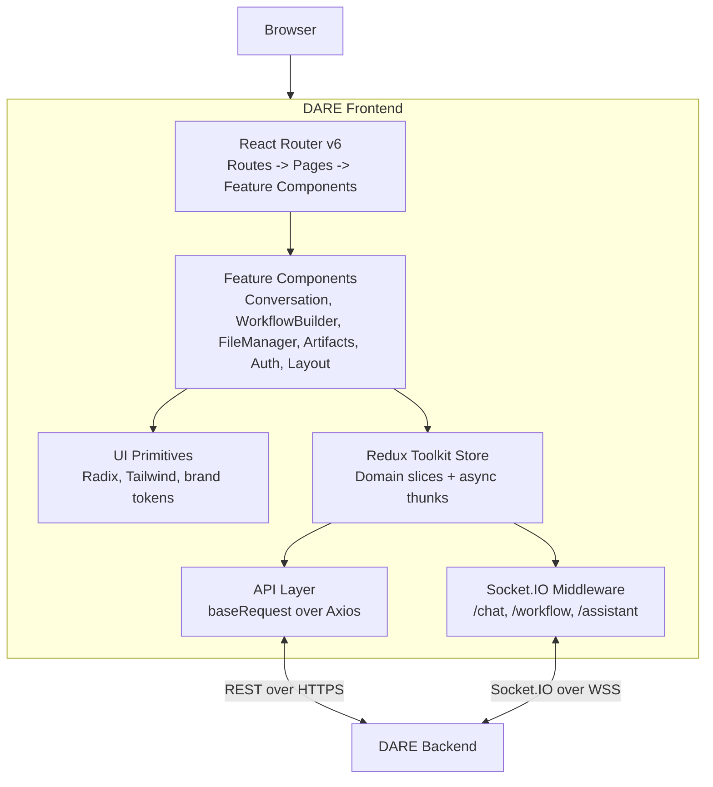

The DARE frontend is a static React 18 single-page app. Pages render feature components; a Redux
Toolkit store holds server-backed state; thunks call the backend over REST through a small Axios
layer; and three Socket.IO middlewares stream chat, workflow and assistant events into the same
store. Vite builds it into `dist/`, alongside the docs site from `docs-site/`. For the backend's
view of the same system, see
[dare-backend/docs/explanation/architecture.md](/docs/explanation/architecture).

## Overview



## Components

| Path                  | Owns                                                                                                             |
| --------------------- | ---------------------------------------------------------------------------------------------------------------- |
| `src/routes/`         | `AppRoutes.tsx`, `ProtectedRoute.tsx` and `RouteListener.tsx`                                                    |
| `src/pages/`          | Top-level pages                                                                                                  |
| `src/components/`     | UI by feature (`Conversation/`, `WorkflowBuilder/`, `FileManager/`, `Artifacts/`, …) and `ui/` shadcn primitives |
| `src/redux/`          | The store, one `&lt;feature&gt;Slice.ts` per domain, `asyncThunks/`, `middleware/`, `types/` and `workflowBuilder/`    |
| `src/api/`            | HTTP calls, one file per domain                                                                                  |
| `src/schemas/`        | Zod schemas for inbound `/workflow` and `/assistant` socket events                                               |
| `src/config/`         | `environment.ts` (typed `VITE_*` config) and `socket.ts` (reconnect policy)                                      |
| `src/themes/`         | One CSS file per theme                                                                                           |
| `src/utils/requests/` | `baseRequest`, the single Axios wrapper                                                                          |

## State management

Redux Toolkit organizes state by domain. Slices sit directly in `src/redux/` as
`&lt;feature&gt;Slice.ts` (for example `conversationSlice.ts`, `fileSlice.ts`, `workflowSlice.ts`,
`billingSlice.ts`, `themeSlice.ts`, `featureFlagsSlice.ts`); `src/redux/slices/socketSlice.ts`
tracks connection state, and `src/redux/workflowBuilder/` holds the canvas state (nodes, edges,
execution, batches). `src/redux/store.ts` registers them all.

- Every slice uses `createSlice`.
- Async operations use `createAsyncThunk`, one file per domain in `src/redux/asyncThunks/`.
- Components use the typed `useAppDispatch` and `useAppSelector` from `src/redux/hooks.ts`.
- Middleware owns the Socket.IO lifecycle: connect, reconnect and dispatch on each event.

## REST requests

```
Component → dispatch(thunk) → src/api/<domain>.ts → baseRequest → axios → Backend
  → thunk fulfilled → slice updates state → component re-renders
```

- **Base URL.** `src/config/environment.ts` reads `VITE_DJANGO_BACKEND_URL`; `src/api/config.ts`
  re-exports it.
- **Auth.** `baseRequest` in `src/utils/requests/index.ts` adds `Authorization: Bearer &lt;token&gt;`
  from `localStorage`. On a `401` it hands off to `tokenExpirationService`
  (`src/services/tokenExpirationService.ts`), which also checks token health every 15 seconds. When
  the token is no longer valid it clears the stored tokens, queues a "Session Expired" toast and
  signs the user out. There is no refresh-token interceptor.
- **Errors.** `getErrorMessage` in `src/utils/errorHandler.ts` turns DRF error shapes into
  user-facing messages.
- **Types.** Response interfaces in `src/redux/types/` define the wire shapes.

## Socket.IO

Three namespaces, three middleware files, one connection lifecycle each. All connect to the
`VITE_DJANGO_BACKEND_URL` origin at path `/socket.io/`, send the JWT in `auth.token`, and try
WebSocket before long polling. `src/config/socket.ts` limits reconnects to two attempts.

| Namespace    | Middleware                     | Used by                                                |
| ------------ | ------------------------------ | ------------------------------------------------------ |
| `/chat`      | `socketMiddleware.ts`          | Streaming completions, artifact emission, message acks |
| `/workflow`  | `workflowSocketMiddleware.ts`  | DAG execution, per-step progress, batch run updates    |
| `/assistant` | `assistantSocketMiddleware.ts` | The Ask DARE platform assistant                        |

Inbound `/workflow` and `/assistant` events are validated with the Zod schemas in
`src/schemas/workflowSocket.ts` and
`src/schemas/assistantSocket.ts` before they reach Redux.
Schema drift on the backend then surfaces as a typed error instead of a silently broken UI.

The backend's [Socket.IO event reference](/docs/reference/socketio-events)
has the full contract: payload shapes, directions and error codes.

## Routing

```tsx
<Route path='/login' element={<LoginScreen />} />
<Route path='/workflows/create' element={
  <ProtectedRoute>
    <WorkflowCreatePage />
  </ProtectedRoute>
} />
```

- `ProtectedRoute` redirects to `/login` when there is no signed-in user or the user is inactive,
  and to `/onboarding` when the user has not finished onboarding.
- `RouteListener` (`src/routes/RouteListener.tsx`) runs on every navigation: it clears the user
  error, resets the workflow builder when you leave a workflow edit route, and updates the active
  conversation.

## Styling and theming

- **Tailwind CSS v4** is the utility layer, loaded with `@tailwindcss/vite`. There is no
  `tailwind.config.ts`: brand tokens and the DARE gradient are defined in `src/index.css`
  (`@theme inline`).
- **shadcn/ui** supplies the accessible primitives in `src/components/ui/`, styled with the same
  tokens.
- **Themes.** Each theme is a CSS file in `src/themes/`, imported by `src/index.css`.
  `ThemeProvider` sets `data-theme` on `&lt;body&gt;` and toggles the `dark` class on it for dark mode.
- **Class merging** uses `cn()` from `src/lib/utils.ts` (`clsx` + `tailwind-merge`).

## Build

- **Vite** runs the dev server and the production build. The `@/` alias maps to `src/`.
- `npm run build` runs `tsc -b && vite build`, then builds `docs-site/` (a static Next.js export)
  and copies it into `dist/docs` and `dist/_next`. In development, a small Vite plugin serves
  `docs-site/out` at `/docs`.
- Vite fingerprints asset names, so production can cache them as immutable (see
  [docs/how-to/deploy.md](/docs/how-to/deploy-frontend)).
- **Sentry** reports browser errors, traces and session replays (inputs masked) when
  `VITE_SENTRY_DSN` is set; it is initialized in `src/main.tsx`.

## Further reading

- [docs/reference/configuration.md](/docs/reference/frontend-configuration): Vite environment variables
- [docs/reference/rules.md](/docs/reference/frontend-rules): coding rules and project conventions
- [.github/CONTRIBUTING.md](/docs/how-to/contribute-frontend): the PR process
- [dare-backend/docs/reference/socketio-events.md](/docs/reference/socketio-events):
  the full event contract
