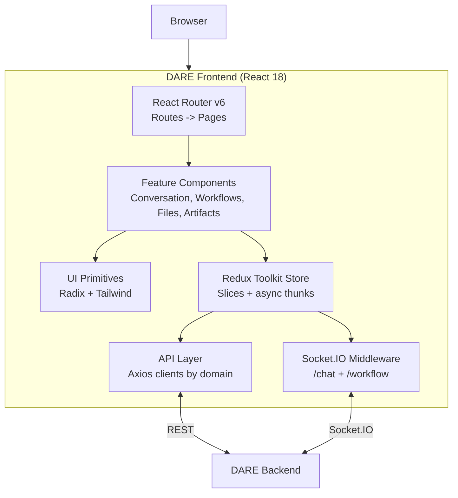

[](/docs/reference/license)
[](https://nodejs.org/)

> React/TypeScript frontend for the **Dietrich Analysis Research Education (DARE) Platform**.

## Table of Contents

- [What is DARE?](#what-is-dare)
- [Screenshots](#screenshots)
- [Overview](#overview)
- [Quick Start](#quick-start)
- [Documentation](#documentation)
- [Tech Stack](#tech-stack)
- [What is included in this repo?](#what-is-included-in-this-repo)
- [What is not included in this repo?](#what-is-not-included-in-this-repo)
- [Stay in touch](#stay-in-touch)
- [Acknowledgements](#acknowledgements)
- [Contributors](#contributors)
- [License](#license)

## What is DARE?

The Dietrich Analysis Research Education (DARE) Platform is an open-source, multi-LLM research and
conversation platform. It provides a single, vendor-agnostic interface to OpenAI, Anthropic Claude,
Google Gemini, and self-hosted LLaMA models, with file-grounded retrieval (RAG), Model Context
Protocol (MCP) tool integration, visual multi-step workflows, and real-time streaming. DARE is
built for researchers and institutions that need more than a chatbot — document intelligence,
reproducible workflows, and per-user usage tracking in one place.

**This repository is the DARE web frontend** — the primary user interface for the platform. It
connects to the [DARE backend](https://github.com/cmudco/dare-backend/) over REST and Socket.IO and gives users:

- **Multi-LLM chat** — streaming conversations with OpenAI, Anthropic, Google, and self-hosted LLaMA models
- **File-grounded RAG** — upload documents and reference them in chat
- **Visual workflow builder** — design and run multi-step AI workflows as a DAG
- **Prompt templates** — reusable, parameterized prompts
- **Artifacts** — rich rendering for code, diagrams, and documents emitted by the model
- **MCP integration** — connect to Model Context Protocol servers for tool use

> **DARE runs standalone.** The DARE frontend and backend are all you need to run the platform —
> nothing else is required. SocraticBooks is a separate, optional platform built on top of DARE.

## Screenshots

**Usage dashboard** — activity, conversations, tokens, and wallet balance, all at a glance the
moment you land:

&lt;p align="center"&gt;
  &lt;img src="public/screenshots/dashboard.png" alt="DARE usage dashboard overview showing AI messages, conversations, files, token counts, and wallet balance" width="900" /&gt;
&lt;/p&gt;

|                                                                                                                                                                                                          |                                                                                                                                                                                                                                                                                         |
| :------------------------------------------------------------------------------------------------------------------------------------------------------------------------------------------------------: | :-------------------------------------------------------------------------------------------------------------------------------------------------------------------------------------------------------------------------------------------------------------------------------------: |
| **Multi-LLM chat** — streaming conversations with per-conversation tools and controls&lt;br/&gt;&lt;img src="public/screenshots/conversation.png" alt="Conversation view with configuration panel" width="440" /&gt; |                                              **Workflow builder** — multi-step pipelines with conditional routing and human validation&lt;br/&gt;&lt;img src="public/screenshots/workflows.png" alt="Visual workflow builder canvas" width="440" /&gt;                                              |
|  **Research mode** — agent-gathered sources, human-reviewed before becoming knowledge&lt;br/&gt;&lt;img src="public/screenshots/research-mode.png" alt="Research workspace with review pipeline" width="440" /&gt;   |                                              **Cost tracking** — a wallet per user, a ledger per message&lt;br/&gt;&lt;img src="public/screenshots/cost-wallet.png" alt="Cost tracking with wallet balance and transaction history" width="440" /&gt;                                               |
|                   **Files & RAG** — upload and tag a corpus, ground answers in it&lt;br/&gt;&lt;img src="public/screenshots/files.png" alt="File manager with processing status" width="440" /&gt;                   | **Environmental impact** — every message metered for energy, carbon, and water, with per-model breakdowns and real-world equivalents&lt;br/&gt;&lt;img src="public/screenshots/environmental-usage.png" alt="Environmental impact dashboard with energy, carbon, and water usage" width="440" /&gt; |

## Overview



The frontend is a static single-page app: a Redux Toolkit store drives feature components, an Axios
API layer talks REST to the backend, and Socket.IO middleware streams chat and workflow events. See
[docs/explanation/architecture.md](/docs/explanation/frontend-architecture) for the full diagram and component breakdown.

## Quick Start

Get the frontend running locally in about two minutes:

```bash
git clone https://github.com/cmudco/dare-frontend.git
cd dare-frontend
npm install
cp .env.example .env      # defaults assume a backend on http://localhost:8000
npm run dev               # Vite dev server on http://localhost:5173
```

**Prerequisites:** Node.js 18+ and a running `DARE backend` (default `http://localhost:8000`).

See **[docs/tutorials/quickstart.md](/docs/tutorials/frontend-quickstart)** for the full local-setup walkthrough, and
**[docs/how-to/deploy.md](/docs/how-to/deploy-frontend)** for building and serving `dist/` in production.

## Prerequisites

- Node.js 18+
- A running [DARE backend](https://github.com/cmudco/dare-backend/) (default `http://localhost:8000`)

## Available Scripts

| Command           | Description                            |
| ----------------- | -------------------------------------- |
| `npm run dev`     | Start the Vite dev server on port 5173 |
| `npm run build`   | Produce a production bundle in `dist/` |
| `npm run preview` | Serve the production bundle locally    |
| `npm run lint`    | Run ESLint over `src/`                 |
| `npm run format`  | Run Prettier                           |

## Documentation

| Kind        | Doc                                                                | What's in it                                                                    |
| ----------- | ------------------------------------------------------------------ | ------------------------------------------------------------------------------- |
| Tutorial    | [docs/tutorials/quickstart.md](/docs/tutorials/frontend-quickstart)                                     | Run the frontend locally — clone, install, configure, `npm run dev`             |
| How-to      | [docs/how-to/deploy.md](/docs/how-to/deploy-frontend)                                     | Production deployment — build and serve `dist/`, with an optional Docker recipe |
| Reference   | [docs/reference/configuration.md](/docs/reference/frontend-configuration)                     | Every Vite environment variable, with type, default, and description            |
| Explanation | [docs/explanation/architecture.md](/docs/explanation/frontend-architecture)                       | Component diagram, state management, Socket.IO integration                      |
| Explanation | [docs/explanation/document-processing.md](/docs/explanation/document-processing)         | Basic and Advanced document processing, and what Advanced costs                 |
| Project     | [.github/CONTRIBUTING.md](/docs/how-to/contribute-frontend), [docs/reference/rules.md](/docs/reference/frontend-rules) | How to contribute; project conventions and constraints                          |
| Project     | [CHANGELOG.md](/docs/reference/changelog), [.github/SECURITY.md](/docs/reference/security)           | Release notes; vulnerability disclosure                                         |

`docs-site/` renders these pages, together with the backend's, as the app's `/docs` site.

## Tech Stack

- **React 18** + **TypeScript**
- **Vite** for build and dev server
- **Redux Toolkit** for state management
- **React Router v6**
- **Tailwind CSS** + **Shadcn/ui** (Radix UI primitives)
- **Socket.IO Client** for real-time chat and workflow streaming
- **Formik + Yup** for forms
- **Zod** for runtime validation of Socket.IO events
- **Axios** for HTTP

## What is included in this repo?

- `src/` — all application source code:
  - `api/` — API layer (one file per domain)
  - `components/` — UI components by feature (`Conversation/`, `WorkflowBuilder/`, `FileManager/`, `Artifacts/`, `Layout/`, and `ui/` primitives)
  - `redux/` — store, slices, async thunks, Socket.IO middleware, types, and workflow-canvas state
  - `pages/`, `routes/`, `schemas/` (Zod), `config/`, and `utils/`
- `docs/` — architecture, configuration, and project rules
- Supporting docs — `docs/tutorials/quickstart.md`, `docs/how-to/deploy.md`, `.github/CONTRIBUTING.md`, `CHANGELOG.md`, `.github/SECURITY.md`

## What is not included in this repo?

- [dare-backend](https://github.com/cmudco/dare-backend/) — the Django REST + Socket.IO backend this frontend depends on (run it separately)
- [socraticbooks-frontend](https://github.com/cmudco/socraticbots-frontend/) — the SocraticBooks frontend (Private Repo for now)
- [socraticbooks-backend](https://github.com/cmudco/socraticbots-backend/) — the SocraticBooks backend that proxies to DARE (Private Repo for now)

## Stay in touch

- **Found a bug or have a feature request?** Open an issue on the project's GitHub repository.
- **Questions or general inquiries?** Email the project team at vks@andrew.cmu.edu.
- **Security disclosures:** see [.github/SECURITY.md](/docs/reference/security).

## Acknowledgements

DARE is an Open Forum for AI (OFAI) initiative, Carnegie Mellon University Libraries.

The DARE name and marks are owned by Carnegie Mellon University. Use of the name, wordmark,
Scotty dog mark, header lockup, and footer badge is governed by the
[DARE Brand Guidelines & Usage Policy](/docs/reference/brand), independently of the software license.

This software integrates with third-party APIs (Anthropic, OpenAI, Google, and others); use of those
APIs is subject to each provider's own Terms of Service.

## Contributors

DARE is built and maintained by contributors at Carnegie Mellon University and in the open-source community.

**Creators**

&lt;table&gt;
  &lt;tr&gt;
    &lt;td align="center" valign="top" width="33.33%"&gt;&lt;img src="https://ui-avatars.com/api/?name=Sayeed+Choudhury&size=100&background=162B4B&color=fff" width="100" height="100" style="border-radius:50%" alt="Sayeed Choudhury" /&gt;&lt;br /&gt;&lt;sub&gt;&lt;b&gt;Sayeed Choudhury&lt;/b&gt;&lt;/sub&gt;&lt;br /&gt;Creator&lt;/td&gt;
    &lt;td align="center" valign="top" width="33.33%"&gt;&lt;img src=".github/assets/team/vince.png" width="100" height="100" style="border-radius:50%" alt="Vincent Sha" /&gt;&lt;br /&gt;&lt;sub&gt;&lt;b&gt;Vincent Sha&lt;/b&gt;&lt;/sub&gt;&lt;br /&gt;Creator&lt;/td&gt;
    &lt;td align="center" valign="top" width="33.33%"&gt;&lt;img src=".github/assets/team/george.png" width="100" height="100" style="border-radius:50%" alt="George Cann" /&gt;&lt;br /&gt;&lt;sub&gt;&lt;b&gt;George Cann&lt;/b&gt;&lt;/sub&gt;&lt;br /&gt;Creator&lt;/td&gt;
  &lt;/tr&gt;
&lt;/table&gt;

**Team**

&lt;table&gt;
  &lt;tr&gt;
    &lt;td align="center" valign="top" width="33.33%"&gt;&lt;img src=".github/assets/team/carl.png" width="100" height="100" style="border-radius:50%" alt="Carl Skipper" /&gt;&lt;br /&gt;&lt;sub&gt;&lt;b&gt;Carl Skipper&lt;/b&gt;&lt;/sub&gt;&lt;br /&gt;Contributor&lt;/td&gt;
    &lt;td align="center" valign="top" width="33.33%"&gt;&lt;img src="https://ui-avatars.com/api/?name=Muhammad+Abdurrehman&size=100&background=162B4B&color=fff" width="100" height="100" style="border-radius:50%" alt="Muhammad Abdurrehman" /&gt;&lt;br /&gt;&lt;sub&gt;&lt;b&gt;Muhammad Abdurrehman&lt;/b&gt;&lt;/sub&gt;&lt;br /&gt;Team Lead&lt;/td&gt;
    &lt;td align="center" valign="top" width="33.33%"&gt;&lt;img src="https://ui-avatars.com/api/?name=Brian+Wingenroth&size=100&background=162B4B&color=fff" width="100" height="100" style="border-radius:50%" alt="Brian Wingenroth" /&gt;&lt;br /&gt;&lt;sub&gt;&lt;b&gt;Brian Wingenroth&lt;/b&gt;&lt;/sub&gt;&lt;br /&gt;Developer&lt;/td&gt;
  &lt;/tr&gt;
  &lt;tr&gt;
    &lt;td align="center" valign="top" width="33.33%"&gt;&lt;img src="https://ui-avatars.com/api/?name=Farhat+Abbas&size=100&background=162B4B&color=fff" width="100" height="100" style="border-radius:50%" alt="Farhat Abbas" /&gt;&lt;br /&gt;&lt;sub&gt;&lt;b&gt;Farhat Abbas&lt;/b&gt;&lt;/sub&gt;&lt;br /&gt;Developer&lt;/td&gt;
    &lt;td align="center" valign="top" width="33.33%"&gt;&lt;img src="https://ui-avatars.com/api/?name=Hariss+M&size=100&background=162B4B&color=fff" width="100" height="100" style="border-radius:50%" alt="Hariss M." /&gt;&lt;br /&gt;&lt;sub&gt;&lt;b&gt;Hariss M.&lt;/b&gt;&lt;/sub&gt;&lt;br /&gt;Developer&lt;/td&gt;
    &lt;td align="center" valign="top" width="33.33%"&gt;&lt;img src="https://ui-avatars.com/api/?name=Eira+Khan&size=100&background=162B4B&color=fff" width="100" height="100" style="border-radius:50%" alt="Eira Khan" /&gt;&lt;br /&gt;&lt;sub&gt;&lt;b&gt;Eira Khan&lt;/b&gt;&lt;/sub&gt;&lt;br /&gt;QA&lt;/td&gt;
  &lt;/tr&gt;
&lt;/table&gt;

## License

This project is licensed under the [GNU Affero General Public License v3.0](/docs/reference/license) (AGPL-3.0-only).
The software license does not grant rights to the DARE name or marks; see the
[DARE Brand Guidelines & Usage Policy](/docs/reference/brand).

See the [LICENSE](/docs/reference/license) file for the full license text, or visit &lt;https://www.gnu.org/licenses/agpl-3.0.en.html&gt;.
