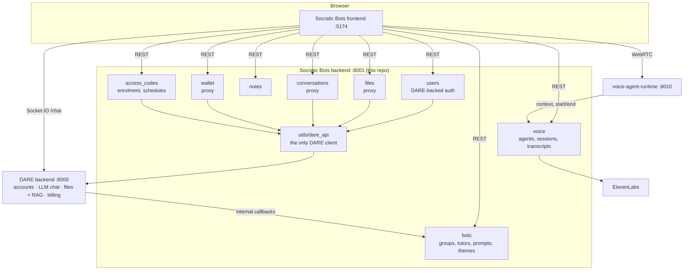
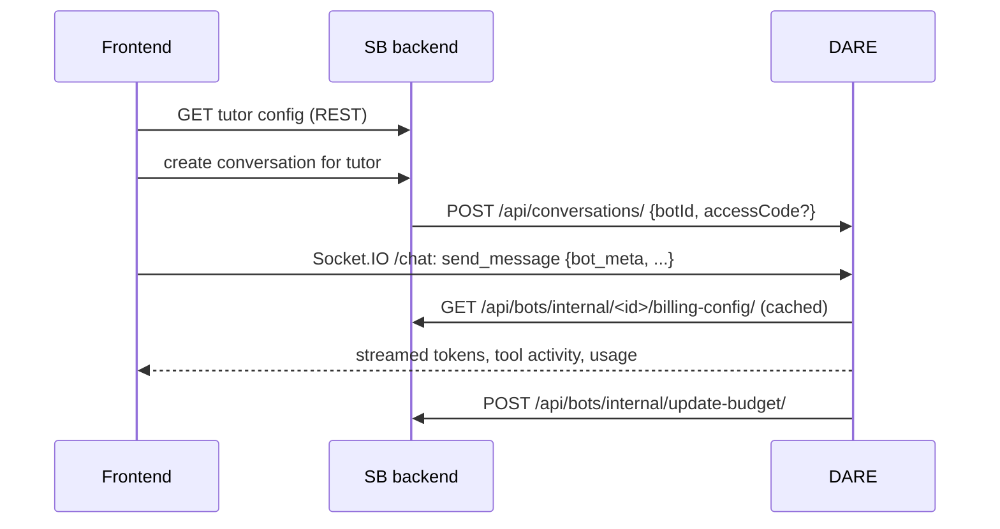

Socratic Bots splits work between four services: the frontend, this backend, DARE, and the
optional voice runtime. This backend is the system of record for the teaching layer (tutors,
access codes, notes, voice agents) and the bridge to DARE, which owns accounts, chat, files and
billing. It runs no models and stores no embeddings, and chat never passes through it.

## Overview

## Who owns what

| Data | Owner | Notes |
| --- | --- | --- |
| User accounts, passwords, roles | DARE | This backend keeps a mirror `CustomUser` (email + `external_user_id`) created on first sign-in. Roles are not stored here. |
| Tutor groups, tutors, prompts, themes, quick prompts | This backend | `bots` app. A tutor stores the DARE file IDs it uses, not the files. |
| Access codes for tutors, group schedules | This backend | `access_codes` app. Registration codes are DARE access code groups. |
| Notes | This backend | `notes` app, one set per user per tutor. |
| Voice agents, memberships, voice conversations, transcripts | This backend | `voice` app. |
| Conversations and messages | DARE | `conversations` here is a proxy with owner-side read views. |
| Files, parsing, chunks, embeddings | DARE | `files` here is a proxy scoped to a tutor. |
| Models, wallets, transactions, provider and LiteLLM keys | DARE | `wallet` and `bots/dare-llms` are proxies. |

## Apps

| App | Installed | Purpose |
| --- | --- | --- |
| `core` | — | Settings, root URLs, Sentry setup |
| `users` | yes | `CustomUser`, DARE JWT authentication, login/registration proxy, notifications proxy |
| `bots` | yes | `BotGroup`, `Bot`, `BotPrompt`, `BotTheme`, `BotQuickPrompt`, `BotModelPreference`, internal endpoints DARE calls |
| `access_codes` | yes | `SubscriptionCode`, `SubscriptionCodeAcceptance`, `BotGroupSchedule`, registration with DARE codes |
| `notes` | yes | `Note` |
| `files` | yes | No models; proxies tutor files to DARE |
| `voice` | yes | Voice agents, teams, access, conversations, browser diagnostics, runtime and webhook endpoints |
| `conversations` | URLs only | No models; proxies DARE conversations |
| `wallet` | URLs only | No models; proxies DARE billing |
| `common` | — | Shared DRF permissions |
| `utils` | — | `dare_api/` client package and `internal_auth.require_internal_key` |

## URL map

| Prefix | What it serves |
| --- | --- |
| `admin/` | Django admin (local data only) |
| `api/users/` | `login/`, `register/`, `token/refresh/`, `token/verify/`, `logout/`, `me/`, `forgot-password/`, notifications, internal user deletion |
| `api/bot-groups/`, `api/bot-groups/<id>/bots/` | Tutor groups and tutors (nested routers) |
| `api/bots/dare-llms/` | Models available to the user, from DARE |
| `api/bots/internal/` | Endpoints DARE calls with `X-Internal-Key`: budgets, billing config, model and LiteLLM key dependents |
| `api/access-codes/` | Register with a code, redeem a tutor code, list, generate and revoke per-tutor codes |
| `api/conversations/` | Tutor conversations, owner views of user and anonymous conversations, public tutor endpoints, PDF export |
| `api/files/bots/<bot_id>/` | List, upload, delete, download a tutor's files |
| `api/notes/` | Notes |
| `api/voice/` | Agents, conversations, Mistral voice list, lab sessions, ElevenLabs webhook, runtime callbacks |
| `api/wallet/` | Wallets, transactions, effective policy, LiteLLM keys, provider keys, per-tutor usage |

## Authentication

1. The frontend posts email and password to `api/users/login/`.
2. This backend forwards them to DARE (`/api/dj-rest-auth/login/`). DARE returns its JWT pair.
3. If no local user exists for that email, one is created and linked by `external_user_id`.
4. On later requests, `users.authentication.JWTAuthentication` verifies the bearer token with
   `SSO_JWT_KEY`, finds the local user by the token's email claim, and asks DARE for the user's
   current platform role.

Roles map to two capabilities:

| DARE role | Socratic Bots capability |
| --- | --- |
| `SUPERADMIN`, `SUPERVISOR` | Creator, plus managing other creators' tutors and agents |
| `CREATOR`, `RESEARCHER` | Creator: build tutors and voice agents |
| `USER`, `SB_USER` | Student: use tutors shared with them |

Service-to-service calls in both directions carry `X-Internal-Key: $DARE_INTERNAL_KEY`. Views
DARE calls are wrapped with `utils.internal_auth.require_internal_key`; the voice runtime callbacks
in `voice/api/runtime_views.py` make the same check. Both reject every request while the key is
empty.

## Chat

The frontend talks to DARE directly for chat; this backend only serves the tutor config and
DARE's billing callbacks.

The frontend sends the tutor's settings (prompt, model, files, retrieval mode, history window,
tracker) as `bot_meta` with each message. DARE runs the model, retrieves from the tutor's files,
bills the chatter's wallet (or the tutor's sponsored key), and reports spend back so this backend
can enforce the tutor's budget. Anonymous visitors on a public tutor link use a session ID
instead of a JWT.

## Files

Uploads go to `api/files/bots/<bot_id>/`. This backend forwards the file to DARE, and DARE's
background worker parses and indexes it. The tutor stores the resulting DARE file IDs in
`Bot.dare_file_ids`. Downloads and deletes are proxied the same way.

## Voice

Two providers are supported, chosen per agent.

**Self-hosted runtime (`mistral_pipecat`).**

1. The student starts an attempt. This backend checks access and attempt limits, reserves a
   `VoiceConversation`, and returns the runtime's WebRTC URL, ICE servers, and a signed session
   token (HMAC with `VOICE_RUNTIME_SESSION_SECRET`).
2. The browser connects to the runtime directly.
3. The runtime fetches the session context (prompt, voice, limits) from
   `api/voice/runtime/sessions/<id>/context/`, then reports `conversation-started` and
   `conversation-ended` with the transcript.
4. This backend stores the transcript and can render it as a PDF.

**ElevenLabs.** This backend creates the agent on ElevenLabs and hands the browser a signed URL.
ElevenLabs posts the finished conversation to `api/voice/webhook/elevenlabs/`, verified with
`ELEVENLABS_WEBHOOK_SECRET`.

`manage.py expire_voice_startups` expires abandoned startup leases without touching active exams.
It only runs when `VOICE_RUNTIME_STARTUP_CLAIMS_ENABLED=true`; schedule it every minute.
`manage.py update_agent_webhooks` links existing ElevenLabs agents to the configured webhook.

## DARE endpoints this backend calls

All calls live in `backend/utils/dare_api/`.

| Module | DARE endpoints |
| --- | --- |
| `auth.py` | `/api/dj-rest-auth/{login,registration,user,password/reset}/`, `/api/access-codes/check/`, `/api/internal/voice-access-codes/`, `/api/internal/sync-access-code/` |
| `conversations.py` | `/api/conversations/` and `/{id}/`, `/{id}/messages/`, `/{id}/export-pdf/`, `/api/messages/{id}/soft-delete/`, `/api/anonymous-conversations/`, `/api/internal/user-conversations/`, `/api/internal/conversations/{id}/messages/` |
| `files.py` | `/api/files/` and `/{id}/`, `/job-statuses/`, `/bulk-delete/`, `/{id}/view/`, `/move/`, `/api/folders/`, `/api/internal/upload/` |
| `models.py` | `/api/llms/`, `/api/llms/all_models/`, `/api/llms/{id}/`, `/api/internal/bot-model-check/` |
| `notifications.py` | `/api/notifications/` and its actions |
| `wallets.py` | `/api/billing/wallets/…`, `/api/billing/transactions/`, `/api/billing/effective-policy/`, `/api/billing/bots/{id}/usage/`, `/api/user-api-keys/…` |

Adding a DARE call anywhere else is a review blocker.

## Further reading

- [docs/reference/configuration.md](/docs/socratic-bots/reference/backend-configuration): the keys and URLs that wire the
  services together.
- [docs/reference/rules.md](/docs/socratic-bots/reference/backend-rules): coding rules, including the DARE client rule.
- [docs/how-to/deploy.md](/docs/socratic-bots/how-to/deploy-backend): running the backend on a server.
- [DARE architecture](https://github.com/cmudco/dare-backend/blob/dev/docs/explanation/architecture.md):
  the other side of every call above.
