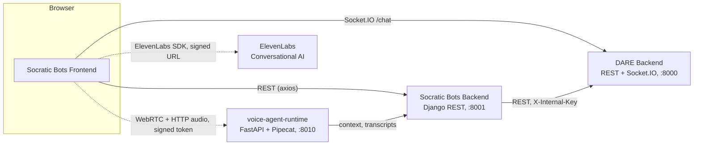

The Socratic Bots frontend is a React single-page app. It owns no data: tutors, codes, notes, and
voice agents live in the Socratic Bots backend; accounts, conversations, files, models, and billing
live in DARE. The app is a thin client over three services: REST to the Socratic Bots backend,
Socket.IO chat straight to DARE, and WebRTC voice to the voice runtime or ElevenLabs.

## Overview

| Traffic                 | From → to                        | Configured by               |
| ----------------------- | -------------------------------- | --------------------------- |
| All REST                | Frontend → Socratic Bots backend | `VITE_API_URL`              |
| Chat streaming          | Frontend → DARE `/chat`          | `VITE_DARE_SOCKET_URL`      |
| Voice (Mistral/Pipecat) | Frontend → voice runtime         | Signed URL from the backend |
| Voice (ElevenLabs)      | Frontend → ElevenLabs            | Signed URL from the backend |
| Billing link            | Frontend → DARE web app          | `VITE_DARE_FRONTEND_URL`    |

The frontend never calls DARE's REST API directly. The Socratic Bots backend proxies everything it
needs from DARE (login, files, models, wallets, conversation history).

## Components

| Path                                                            | What lives there                                                                                                         |
| --------------------------------------------------------------- | ------------------------------------------------------------------------------------------------------------------------ |
| `src/App.tsx`                                                   | All routes                                                                                                               |
| `src/pages/`                                                    | Route-level pages                                                                                                        |
| `src/components/`                                               | Feature components (`bots/`, `botGroups/`, `chat/`, `VoiceExam/`, `voice-agents/`, `wallet/`, ...) and `ui/` (shadcn/ui) |
| `src/services/*.service.ts`                                     | One REST client per backend area, all built on `src/utils/baseRequest.ts`                                                |
| `src/services/socket.service.ts`, `src/config/socket.config.ts` | Socket.IO connection to DARE                                                                                             |
| `src/hooks/queries/`                                            | TanStack Query hooks wrapping the services                                                                               |
| `src/stores/core/`                                              | Zustand stores for chat sockets, conversations, public bots, notes, attachments                                          |
| `src/stores/ui/`, `src/stores/forms/`                           | Zustand stores for modals, toasts, theme, and multi-step forms                                                           |
| `src/schemas/`                                                  | Zod schemas (bot form, socket events)                                                                                    |
| `src/lib/`                                                      | Config, Sentry, voice lifecycle and contract helpers                                                                     |
| `src/types/`                                                    | Shared TypeScript types                                                                                                  |
| `src/themes/`, `src/styles/`                                    | Bot chat themes (CSS custom properties)                                                                                  |

### State

- **Server state** (anything fetched over REST) goes through TanStack Query hooks in
  `src/hooks/queries/`. Mutations invalidate the matching query keys.
- **Client state** (socket messages, streaming text, UI toggles, form drafts) lives in Zustand
  stores. The two chat stores (`websocketStore` for signed-in chat, `publicWebSocketStore` for public
  bots) share their event handling through `chatSocketCore.ts`.

### Routes

| Path                                                                           | Page                                | Who       |
| ------------------------------------------------------------------------------ | ----------------------------------- | --------- |
| `/public-deployment/bot/:botId`                                                | Public bot chat                     | Anyone    |
| `/login`, `/register`, `/forgot-password`, `/forgot-password-success`          | Auth pages                          | Anyone    |
| `/`                                                                            | Home (landing page when signed out) | Signed in |
| `/access-codes`                                                                | Subscription codes                  | Signed in |
| `/bot-groups`                                                                  | Chatbot groups                      | Signed in |
| `/bot-groups/:botGroupId/bots/new`, `/bot-groups/:botGroupId/bots/:botId/edit` | Bot editor                          | Creators  |
| `/bot-access`, `/bot-access/:botGroupId/:botId`                                | Users and conversations per bot     | Creators  |
| `/chat`, `/chat/:botId`                                                        | Chat                                | Signed in |
| `/voice-exams`                                                                 | Voice assignments                   | Signed in |
| `/voice-exams/create`, `/voice-exams/:id`                                      | Voice agent editor and detail       | Creators  |
| `/voice-exams/:id/exam`                                                        | Take a voice exam                   | Signed in |
| `/voice-exams/:agentId/conversations[/:id]`                                    | Voice transcripts                   | Creators  |
| `/voice-exams/stt-lab`                                                         | Speech-to-text lab                  | Signed in |
| `/settings`                                                                    | Account, wallet, keys               | Signed in |
| `/about`                                                                       | About                               | Signed in |
| anything else                                                                  | Redirects to `/`                    |           |

"Creators" means the page is built for creator roles. Access is enforced by the Socratic Bots
backend, not by the route.

## Main flows

### Login

1. `/login` posts credentials to `users/login/` on the Socratic Bots backend.
2. The backend forwards them to DARE, gets DARE-issued JWTs, and creates its local user on first
   login.
3. The frontend stores `access_token` and `refresh_token` in `localStorage` (`src/hooks/useLogin.ts`).
   `src/utils/baseRequest.ts` sends `Authorization: Bearer <access_token>` on every REST call.
4. `ProtectedRoute` loads the current user (`useUserInfo`). If that fails, `/` shows the landing
   page and any other protected path redirects to `/login`.

Token refresh is disabled (`authService.refreshToken` throws), so an expired access token sends the
user back to login.

### Chat

1. `ProtectedRoute` opens one Socket.IO connection to DARE (`useSocketConnection`) with
   `auth: { token }`. Public bot pages connect with `auth: { sessionId, conversationId }` instead,
   using an anonymous session id kept in `localStorage` (`src/lib/anonymousSession.ts`).
2. Opening a bot subscribes to its conversation room (`subscribe_conversation`).
3. Sending builds the payload in `src/utils/botChatPayload.ts` from the bot's configuration (model,
   retrieval mode, attached file ids, tracking settings, teaching prompt) and emits `send_message`.
4. DARE runs the model and tools and streams back `message` events (`ai_stream` updates, tool-call
   events, the final message, progress results). The stores in `src/stores/core/` apply them.
5. **Stop** emits `stop_generation`; DARE saves the partial reply and sends it as the final message.

DARE tells Socratic Bots traffic apart from its own by the socket's `Origin`, matched against its
`SOCRATIC_BOTS_FRONTEND_URL`. The full wire format is in
`tests/SOCKET_CONTRACT.md`.

### Bot files

Creators attach documents to a bot on the edit page. Uploads go to `files/bots/<bot_id>/` on the
Socratic Bots backend, which stores them in DARE. DARE ingests them in a background worker; the edit
page polls the file list every five seconds while any file is still processing
(`src/hooks/queries/useBotFiles.ts`).

### Voice exams

1. The student opens `voice-exams/:id/exam`. The frontend calls
   `voice/agents/<id>/get_signed_url/` on the Socratic Bots backend.
2. The backend checks access, reserves a session, and returns a provider-specific answer:
   - **Mistral / Pipecat** (`mistral_pipecat`): a signed WebRTC offer URL on the voice runtime, a
     session token, and ICE servers. `src/hooks/usePipecatWebRTCSession.ts` opens a peer connection,
     posts the SDP offer to the runtime, streams the microphone, and plays the agent's audio from the
     WebRTC track, or from per-utterance WAV files over HTTP as a fallback.
   - **ElevenLabs** (`elevenlabs`): a signed URL for ElevenLabs Conversational AI, used through
     `@elevenlabs/react` in `src/components/VoiceExam/VoiceInterface.tsx`.
3. When the session ends, the runtime (or the ElevenLabs webhook) sends the transcript to the
   backend, and the frontend polls `voice/agents/<id>/session_status/` to show the outcome.

## Further reading

- `tests/SOCKET_CONTRACT.md`: the chat wire contract shared with DARE.
- [docs/reference/configuration.md](/docs/socratic-bots/reference/frontend-configuration): every environment variable.
- [docs/reference/rules.md](/docs/socratic-bots/reference/frontend-rules): coding rules and project conventions.
- [Socratic Bots backend](https://github.com/cmudco/socraticbots-backend) and
  [DARE backend](https://github.com/cmudco/dare-backend): the services this app calls.
