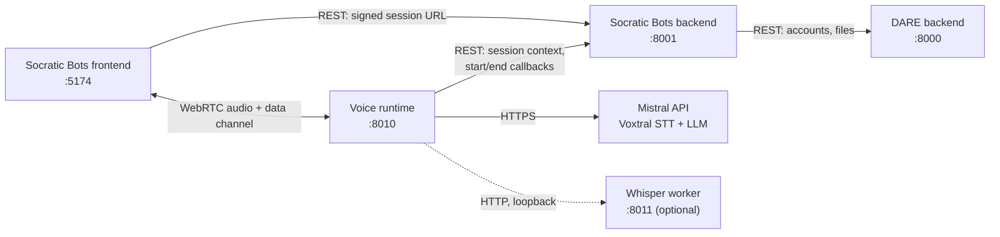
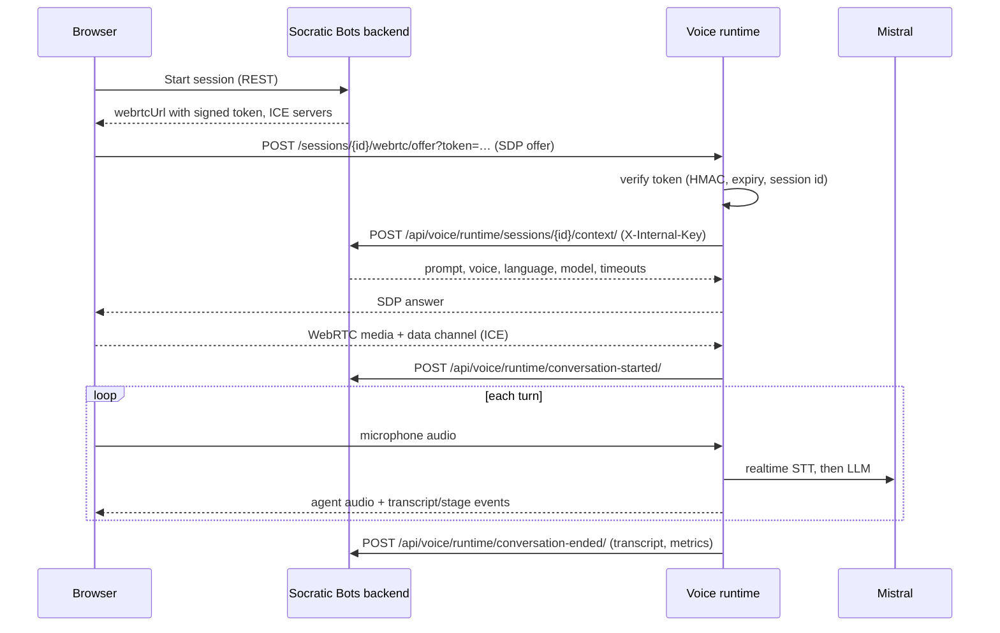

The voice runtime turns a browser microphone into a spoken conversation with a Socratic Bots voice
agent. It is a stateless FastAPI service: the Socratic Bots backend owns agents, permissions, session
records and transcripts; the runtime owns the live audio for the length of one session.

## Overview



## Components

| Component | Where | Role |
| --- | --- | --- |
| FastAPI app | `runtime/pipecat_app.py` | `/health`, the WebRTC offer endpoint, HTTP-WAV utterance downloads, CORS. |
| Exam pipeline | `runtime/pipecat_pipeline.py` | Builds and runs the Pipecat pipeline for a tutoring/exam session. |
| Lab pipeline | `runtime/lab_pipeline.py` | STT Lab: microphone → STT only, everything mirrored to the browser. No LLM, TTS or backend callbacks. |
| Session tokens | `runtime/session_tokens.py` | Verifies the backend-signed token the browser presents. |
| Session context | `runtime/session_context.py` | Fetches the agent's prompt, voice, language and model from the backend. |
| Recorder | `runtime/recorder.py` | Transcript, latency and health metrics; start/end callbacks to the backend. |
| STT resilience | `runtime/stt_resilience.py` | Mistral STT wrapper, liveness watchdog, rebuild-and-replay, Whisper hand-off. |
| LLM resilience | `runtime/llm_resilience.py`, `runtime/llm_providers.py` | First-token deadline and the fallback chain across providers. |
| Turn recovery | `runtime/turn_recovery.py` | Resumes the agent's reply after an interruption that produced no words. |
| Browser events | `runtime/processors.py` | Data-channel messages to and from the browser. |
| HTTP-WAV TTS | `runtime/tts_buffer.py` | Fallback transport: renders replies to WAV files the browser downloads. |
| Whisper worker | `runtime/whisper_worker.py` | Separate process. Optional faster-whisper STT backup. |

## Session lifecycle



1. **Token.** The backend signs `base64url(json_payload).hex_hmac_sha256` with
   `VOICE_RUNTIME_SESSION_SECRET` (or `DARE_INTERNAL_KEY`). The payload carries only auth claims:
   `session_id`, `agent_id`, `user_id`, `expires_at`, and `mode` (`exam` or `lab`). The runtime
   rejects a missing, badly signed or expired token, or one whose session id does not match the URL,
   with `401`.
2. **Context.** For `exam` sessions the runtime fetches the full configuration server-to-server. It
   tries each URL in `SOCRATIC_BOTS_BACKEND_URLS` in order: `404` means "not my session, try the
   next", `409` means the backend no longer accepts this start (the runtime returns `409` to the
   browser), and the first `200` decides which backend gets the callbacks. Keeping the prompt out of
   the token keeps the offer URL short.
3. **Pipeline.** The runtime answers the SDP offer and starts the pipeline as a background task.
4. **End.** On a manual end, time limit, disconnect or cancel, the recorder posts the transcript,
   duration, end reason and metrics to `conversation-ended/`, retrying up to three times. The call is
   idempotent per session.

## Exam pipeline

Stages in order (`runtime/pipecat_pipeline.py`):

```text
transport.input()                 WebRTC microphone track + data channel (SmallWebRTCTransport)
[AudioInputDebugProcessor]        optional: mic-level telemetry
ClientControlProcessor            end / cancel / client_exit / stt_switch messages from the browser
[SttLivenessWatchdog]             detects a stalled STT connection
Mistral Voxtral realtime STT      ResilientMistralSTTService
user transcript → browser
RecoveryInputProcessor            interruption bookkeeping
user aggregator                   Silero VAD turn detection, builds the LLM context
ElapsedTimestampProcessor         adds elapsed-time markers to the context
RecoveryContextProcessor          re-issues an interrupted reply when needed
[LLMInputDebugProcessor]          optional: dumps LLM input to /tmp
LLM                               ResilientLLMService with the fallback chain
SpeechTextGuard                   strips text that should not be spoken
TTS                               Kokoro (stream) or a buffered Kokoro/Mistral service (HTTP)
BrowserEventProcessor             transcript, speaking/listening/processing, stage events
transport.output()                agent audio on the WebRTC track
assistant aggregator              records the agent's reply in the context
```

Silero VAD lives in the user aggregator. Its thresholds come from the `VOICE_RUNTIME_VAD_*`
settings, except the end-of-turn silence, which follows the agent's **eagerness** setting when the
agent has one. The agent's turn timeout sets how long the agent waits in silence before prompting
the student.

`VoiceStageTap` processors between stages publish sequenced stage events (`listening`,
`transcribing`, `thinking`, `preparing_voice`, `speaking`, `recovering`) that the frontend uses for
its status indicator.

### Speech-to-text and recovery

- **Liveness watchdog.** After VAD closes a turn, the first transcript must arrive within
  `VOICE_RUNTIME_STT_LIVENESS_DEADLINE_SECS`. During continuous speech, a separate check fires when
  there is recent audio, at least two seconds classified as speech, and no new transcript text for
  `VOICE_RUNTIME_STT_PROGRESS_TIMEOUT_SECS`. Either triggers one rebuild of the Mistral connection and
  a replay of the buffered turn.
- **Whisper hand-off.** If the rebuild does not recover and a Whisper worker is configured, the
  retained turn goes to Whisper. An automatic switch is provisional: if the first Whisper batch hears
  no words, the stall is treated as noise and recognition returns to Mistral. A second automatic
  stall in the same session makes the switch permanent. Once Whisper is active, late Mistral
  transcripts are dropped and each VAD-ended turn is transcribed in a batch.
- **Manual switch.** The browser can send `stt_switch`; the acknowledgement means the provider was
  selected, not that transcription succeeded.
- **Limits.** Whisper accepts PCM16 mono 16 kHz, at most 120 seconds per turn, with up to two queued
  batches per session. Overflow, empty recognition, timeouts and overload ask the student to repeat;
  a truncated answer is never submitted as complete. Speech that started more than one second before
  VAD triggered cannot be recovered.

This is a fallback for a failing STT provider. It does not help when the browser sends no audio or
when the WebRTC connection itself fails.

### LLM fallback

The agent's model (from the session context) or `MISTRAL_LLM_MODEL` is tried first, followed by
`VOICE_RUNTIME_LLM_FALLBACKS`. All providers are called through their OpenAI-compatible endpoints
with the `openai` client. A model is abandoned when it errors or its first token takes longer than
`VOICE_RUNTIME_LLM_TTFB_DEADLINE_SECS`, and the next one answers the same turn. Each fallback is
recorded in the session metrics.

### Text-to-speech and transport

| Provider | Transport | Behaviour |
| --- | --- | --- |
| `kokoro` | `webrtc` | Recommended. Local Kokoro audio is resampled to 48 kHz and streamed on the WebRTC track, in order with transcript events. |
| `kokoro` | `http` | Each reply is rendered to a WAV under `/tmp/voice-runtime-audio/<session>/`, announced with `tts_utterance_ready`, and fetched from `/sessions/{id}/utterances/{name}`. |
| `mistral` | `http` | Same HTTP path with Voxtral TTS. Voxtral cannot stream over WebRTC because of provider-side jitter. |

The speaking state ends when the output transport finishes playing, not when the LLM finishes.

### Interruptions and session behaviour

- A student can interrupt the agent (Pipecat interruptions). The partial reply is cancelled without
  flushing a half word as a completed reply.
- If the interruption produced no recognised words, the original reply is regenerated once after 2.5
  seconds without speech. Any recognised word, a newer request or the end of the session cancels the
  retry. A retry can repeat a sentence; it is not an audio continuation.
- A transient WebRTC disconnection gets 8 seconds to recover before teardown.
- `end` and `cancel` requests from the browser are acknowledged with `session_end_ack` carrying the
  request id, so the UI can tell a confirmed end from an unconfirmed one.

## Data the runtime keeps

- **Nothing persistent.** Transcripts and metrics are sent to the backend and dropped.
- **HTTP-WAV transport** writes agent speech (not student audio) to `/tmp/voice-runtime-audio/`.
- **`VOICE_RUNTIME_LLM_INPUT_DEBUG`** writes LLM contexts, which contain student answers, to the same
  directory. Keep it off in production.
- **Whisper** keeps audio in memory only.

## Metrics returned to the backend

`metrics.sessionHealth` in the end callback includes connection success, user and agent transcript
counts, retry and recovery counters, brain fallbacks, the exit reason, and whether a user final
transcript arrived after the last agent audio was queued. Every 10 seconds the runtime also samples
minimum available memory, free swap, peak RSS and event-loop lag (Linux fields only). None of these
prove that the browser played audio or that the student heard it.

Exit reasons are reported as given (`manual_end`, `time_limit`, `route_change`, `page_hidden_exit`,
…); a missing report becomes `unknown_disconnect`, or `connection_not_established` when no
connection succeeded. Nothing is inferred from duration.

## Further reading

- [docs/reference/configuration.md](/docs/socratic-bots/reference/voice-configuration): every setting named on this page
- [docs/how-to/whisper-backup.md](/docs/socratic-bots/how-to/whisper-backup): set up the Whisper STT backup
- [docs/how-to/deploy.md](/docs/socratic-bots/how-to/deploy-voice): TLS, TURN and the preflight gate in production
- [docs/explanation/http-wav-architecture.md](/docs/socratic-bots/explanation/http-wav-architecture): design note on the HTTP-WAV
  TTS transport
