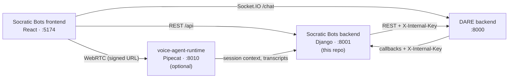

[](/docs/reference/license)
[](https://www.python.org/)
[](https://www.djangoproject.com/)

> The Django REST API behind **Socratic Bots**: educators build Socratic AI tutors and voice exams,
> students learn with them, and DARE does the heavy lifting.

## What is Socratic Bots?

Socratic Bots is an open-source platform for teaching with AI tutors that ask questions instead of
handing out answers. An educator writes a tutor's instructions, attaches course documents, picks a
model, and shares the tutor with a class through an access code or a public link. Students chat
with it, keep notes beside the conversation, and can sit oral exams with a voice agent. Educators
see their students' conversations and what each tutor costs to run.

Socratic Bots is built on [DARE](https://github.com/cmudco/dare-backend), the Dietrich Analysis
Research Education platform from Carnegie Mellon University. DARE owns accounts, model access,
chat generation, document ingestion and retrieval, and billing. Socratic Bots adds the teaching
layer on top.

**This repository is the Socratic Bots backend.** It handles:

- the teaching data: tutor groups, tutors, prompts, themes, notes, access codes, voice agents and
  their transcripts;
- sign-in, by forwarding credentials to DARE and verifying the JWT DARE issues;
- proxying files, conversations, models and wallets to DARE.

It contains no LLM or vector-database code: chat runs in DARE, and the frontend talks to DARE's
chat socket directly.

> **Socratic Bots requires DARE.** You need a running [DARE backend](https://github.com/cmudco/dare-backend)
> to use Socratic Bots: sign-in, chat, files, and wallets all go through it. The reverse is not
> true. DARE is a complete product on its own and does not need Socratic Bots.

## Overview



Users sign in through this backend, which forwards the credentials to DARE. DARE issues the JWT,
and this backend verifies it with a key shared with DARE (`SSO_JWT_KEY`). A user's role (creator or
student) is read from DARE on each request, so a role change in DARE applies straight away.

## Features

- **Tutor builder.** Tutor groups with collaborators, tutors with their own system prompt, model,
  theme, quick prompts, and retrieval settings (fast, thorough, or autonomous search over attached
  documents, plus web search).
- **Course documents.** Upload files to a tutor. DARE stores, parses, and indexes them.
- **Sharing.** Per-tutor access codes for a class, schedules for tutor groups, and public
  deployment links that let anonymous visitors chat.
- **Oversight.** Creators can read their students' conversations and anonymous public sessions, and
  export any conversation as a PDF.
- **Notes.** Students keep notes per tutor next to the chat.
- **Progress tracking.** A tracker prompt and learning goals per tutor, with its own history window.
- **Voice agents and oral exams.** Agents on ElevenLabs or on the self-hosted
  [voice-agent-runtime](https://github.com/cmudco/voice-agent-runtime), with attempt limits,
  retakes, transcripts, and PDF export.
- **Spending.** Pass-through to DARE wallets: provider keys, LiteLLM gateway keys, per-tutor budgets
  and usage.

## Quick start

You need a DARE backend running on `:8000`, and either Python 3.10+ or Docker with Compose.

```bash
git clone https://github.com/cmudco/socraticbots-backend.git
cd socraticbots-backend
cp env.example .env       # set SSO_JWT_KEY and DARE_INTERNAL_KEY to DARE's values
```

Local Python:

```bash
python3 -m venv venv && source venv/bin/activate
pip install -r requirements.txt
cd backend
python manage.py migrate
python manage.py runserver 0.0.0.0:8001
```

Or Docker (also set `DB_PASSWORD` in `.env`, and add `host.docker.internal` to DARE's
`ALLOWED_HOSTS`):

```bash
docker compose up --build -d
```

The API is now at `http://localhost:8001/api/`; `/api/ready/` checks the database and DARE. For the whole stack, including the two keys that
must match DARE, follow [docs/tutorials/quickstart.md](/docs/socratic-bots/tutorials/full-stack-quickstart).

## Documentation

| Kind | Doc | What's in it |
| --- | --- | --- |
| Tutorial | [docs/tutorials/quickstart.md](/docs/socratic-bots/tutorials/full-stack-quickstart) | Run the full stack locally: DARE, this backend, the frontend, and optionally voice |
| How-to | [docs/how-to/deploy.md](/docs/socratic-bots/how-to/deploy-backend) | Run it on a server: Docker or bare metal, reverse proxy, production checklist |
| Reference | [docs/reference/configuration.md](/docs/socratic-bots/reference/backend-configuration) | Every environment variable, and which values must match across services |
| Explanation | [docs/explanation/architecture.md](/docs/socratic-bots/explanation/backend-architecture) | Apps, data ownership, request flows, and the DARE API surface this backend uses |
| Project | [.github/CONTRIBUTING.md](/docs/socratic-bots/how-to/contribute-backend) | Issues, pull requests, checks to run, and AI coding agent setup |
| Project | [docs/reference/rules.md](/docs/socratic-bots/reference/backend-rules) | Backend coding rules |
| Project | [.github/SECURITY.md](/docs/socratic-bots/reference/backend-security) | How to report a vulnerability, and hardening notes |
| Project | `AGENTS.md` | Commands and traps for AI coding agents |
| Project | `BRAND.md` | Trademark and brand usage policy |

## Tech stack

- **Django 5.1** and **Django REST Framework**, camelCase JSON on the wire
- **DARE-issued JWTs** verified with PyJWT; SimpleJWT for token plumbing
- **SQLite** for local development, **PostgreSQL** in production
- **WhiteNoise** for static files, **Gunicorn** in the container
- **httpx / requests** for DARE, ElevenLabs, and Mistral calls
- **WeasyPrint** for voice transcript PDFs
- **Sentry** (optional) for error reporting

## What is included in this repo?

- `backend/` — the Django project: `core` (settings, URLs), and the apps `users`, `bots`, `files`,
  `access_codes`, `notes`, `conversations`, `wallet`, and `voice`
- `backend/utils/dare_api/` — the only place that talks to DARE
- `Dockerfile`, `docker/entrypoint.sh` and `docker-compose.yml` — the backend plus PostgreSQL
- `requirements.txt` and `env.example`
- Agent configuration in `AGENTS.md` and `.agents/`

## What is not included in this repo?

- [dare-backend](https://github.com/cmudco/dare-backend) — accounts, chat, files, retrieval, and billing (**required**)
- [socraticbots-frontend](https://github.com/cmudco/socraticbots-frontend) — the Socratic Bots web app
- [voice-agent-runtime](https://github.com/cmudco/voice-agent-runtime) — the self-hosted Pipecat voice runtime (optional)
- [dare-frontend](https://github.com/cmudco/dare-frontend) — DARE's own web app (not needed to use Socratic Bots)

## Stay in touch

- **Found a bug or want a feature?** Open an issue in this repository.
- **Found a security problem?** Follow [.github/SECURITY.md](/docs/socratic-bots/reference/backend-security); please don't open a public issue.
- **Questions or general inquiries?** Email the project team at vks@andrew.cmu.edu.

## Acknowledgements

Socratic Bots is developed at the Dietrich College of Humanities and Social Sciences, Carnegie
Mellon University, and is built on the [DARE](https://github.com/cmudco/dare-backend) platform.

"DARE" and "SocraticBots" are trademarks of Carnegie Mellon University. See `BRAND.md`
for the brand usage policy, and contact vks@andrew.cmu.edu for trademark or licensing questions.

This software integrates with third-party services (LLM providers through DARE, ElevenLabs,
Mistral, and others). Use of those services is subject to each provider's own terms.

## License

This project is licensed under the [GNU Affero General Public License v3.0](/docs/reference/license)
(AGPL-3.0-only). © 2024–2026 Carnegie Mellon University. If you run a modified version as a network
service, the AGPL requires you to offer your users the source of that version.
